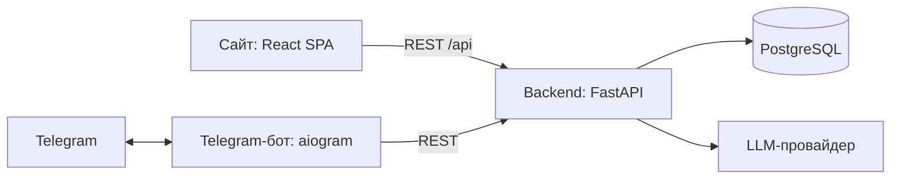

# 2. Архитектура системы

Тип: клиент-сервер; сервер — модульный монолит.

## Почему не микросервисы
TODO: команда из 3 человек, один семестр, общая БД, сложность развёртывания.

## Модули backend
users · learning · vocabulary · dialogs · recommendations · llm

## Привязка Telegram-аккаунта к аккаунту сайта
TODO: одноразовый код / deep-link `t.me/<bot>?start=<code>`.
