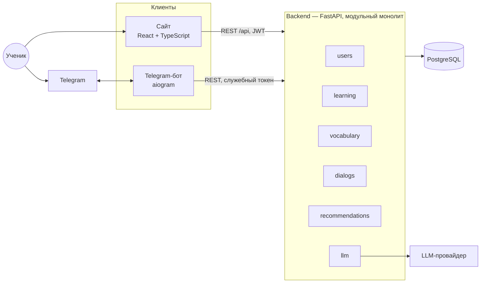
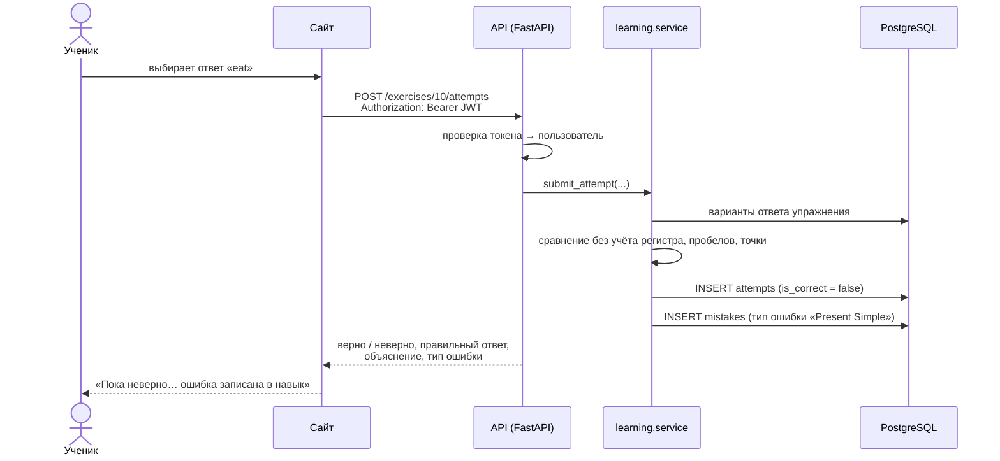
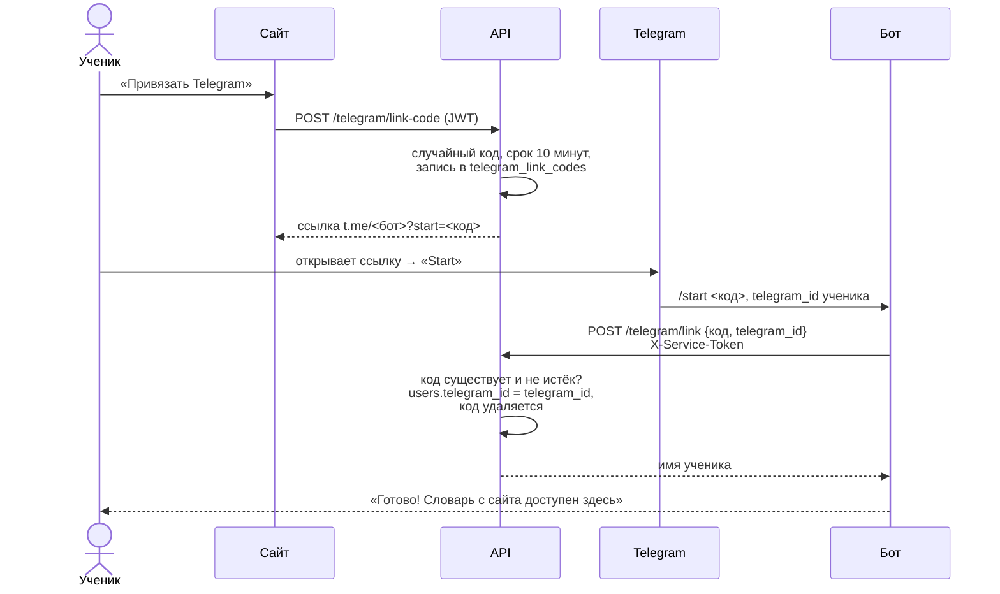

# 2. Архитектура системы

**Тип:** клиент-сервер. Сервер — **модульный монолит**: одно приложение и одна база данных, внутри разделённые на независимые модули.

Главное правило архитектуры: **данными владеет только сервер.** Сайт и бот — два равноправных клиента одного REST API, бот не обращается к базе напрямую. Поэтому ответ, данный на сайте, и слово, повторённое в боте, попадают в одни и те же таблицы, и адаптивность работает по всей истории ученика.

## Компоненты и технологии

| Компонент | Технологии | Почему |
|---|---|---|
| Сайт | React 19, TypeScript, Vite, React Router | Отдельное SPA естественно ложится на клиент-серверную схему; TypeScript ловит ошибки в типах данных API до запуска |
| Сервер (API) | Python 3.12, FastAPI, Pydantic | Асинхронность (бот и запросы к LLM — асинхронные), автоматическая документация API (Swagger), строгая проверка входных данных |
| Работа с БД | SQLAlchemy 2.0, Alembic | Модели в коде, схема меняется только миграциями |
| База данных | PostgreSQL 16 | Обоснование — в `docs/database.md` |
| Telegram-бот | aiogram 3, httpx | Асинхронный фреймворк для ботов; httpx — клиент к нашему API |
| Языковая модель | Модуль `app/llm` с общим интерфейсом `LLMClient` | Провайдер подключается в одном месте; пока работает заглушка, чтобы разрабатывать без ключа |
| Запуск | Docker Compose | Вся система поднимается одной командой одинаково у всех участниц |

## Модули сервера

| Модуль | За что отвечает | Таблицы | Состояние |
|---|---|---|---|
| `users` | Регистрация, вход, текущий пользователь | `users`, `telegram_link_codes` | Работает (привязка Telegram — запланирована) |
| `learning` | Темы, упражнения, проверка ответов, запись ошибок по типам | `topics`, `exercises`, `exercise_answers`, `attempts`, `error_types`, `mistakes` | Работает |
| `vocabulary` | Личный словарь, интервальное повторение SM-2, трудные слова | `words`, `topic_words`, `user_words`, `word_reviews` | Работает |
| `dialogs` | Диалог с виртуальным носителем языка | `dialogs`, `dialog_messages` | Таблицы созданы, логика — следующий этап |
| `recommendations` | План занятий от адаптивного наставника | `lesson_plans`, `lesson_plan_items` | Таблицы созданы, логика — следующий этап |
| `llm` | Общий интерфейс к языковой модели | — | Интерфейс и заглушка |

Внутри модуля код разложен одинаково: `models.py` (таблицы), `schemas.py` (формат запросов и ответов), `service.py` (логика), `router.py` (адреса API). Модуль не лезет в таблицы другого модуля напрямую, а вызывает его `service.py`. Благодаря этому границы модулей можно превратить в границы сервисов, если когда-нибудь понадобится (см. ниже).

## Как проходит запрос

На примере ответа на упражнение — основного действия, на котором строится адаптивность:

Правильные ответы клиент получает **только в ответе на попытку**, никогда — вместе с заданием, иначе их можно было бы подсмотреть в браузере.

## Аутентификация

- **Сайт:** вход по email и паролю → сервер выдаёт JWT-токен, сайт прикладывает его к каждому запросу. Пароли хранятся только как хэш argon2. *Работает.*
- **Бот:** у бота нет пароля пользователя. Он обращается к API со **служебным токеном** (`BOT_SERVICE_TOKEN` из `.env`, заголовок `X-Service-Token`) и указывает, от имени какого Telegram-пользователя действует. Сервер находит ученика по `users.telegram_id`. *Запланировано: токен уже есть в настройках бота и сервера, проверка на сервере — вместе с привязкой Telegram.*

## Привязка Telegram-аккаунта к аккаунту сайта

*Запланировано. Таблица `telegram_link_codes` и поле `users.telegram_id` уже есть в схеме БД.*

Задача: связать ученика на сайте с его Telegram, не прося вводить пароль в боте. Решение — одноразовый код в ссылке на бота (deep-link).

Почему так безопасно:
- код **одноразовый** и живёт **10 минут** — перехваченная старая ссылка бесполезна;
- код **случайный** (например, `secrets.token_urlsafe(16)`, 22 символа — Telegram допускает в параметре `start` до 64 символов `A–Z a–z 0–9 _ -`), подобрать его нельзя;
- привязать аккаунт может только бот: запрос `/telegram/link` принимается лишь со служебным токеном, который хранится в `.env` и не попадает в код и в git;
- `users.telegram_id` уникален — один Telegram нельзя привязать к двум аккаунтам.

После привязки бот вызывает те же адреса API, что и сайт (`/vocabulary/review`, `/vocabulary/{id}/reviews` и т. д. — см. `docs/api-vocabulary.md`), но со служебным токеном и `telegram_id` вместо JWT.

## Почему монолит, а не микросервисы

| Критерий | Модульный монолит | Микросервисы |
|---|---|---|
| Развёртывание | Один контейнер сервера | Отдельный контейнер, конфигурация и мониторинг на каждый сервис |
| Данные | Одна БД, связи защищены внешними ключами | База на сервис; связи между сервисами — только через API, целостность приходится обеспечивать вручную |
| Запрос «слабые места ученика» | Один SQL-запрос с JOIN по ошибкам, ответам и темам | Сбор данных из нескольких сервисов по сети |
| Отладка и тесты | Один процесс, тесты на одной тестовой базе | Нужно поднимать несколько сервисов и эмулировать сеть |
| Команда | 3 человека, 1 семестр | Оправданы, когда разные команды независимо выпускают свои части |

Для команды из трёх человек на один семестр микросервисы добавили бы сложность без выгоды. Особенно мешало бы разделение базы: адаптивность построена на запросах, которые объединяют таблицы разных модулей.

При этом монолит **модульный**: у модулей чёткие границы, и при росте нагрузки отдельную часть можно вынести в сервис. Первый кандидат — модуль `llm`: запросы к языковой модели медленные и дорогие, их удобно масштабировать отдельно.

## Развёртывание

`docker compose up -d` запускает четыре контейнера:

| Сервис | Образ | Порт | Что делает при старте |
|---|---|---|---|
| `db` | `postgres:16` | 5432 | Данные хранятся в томе `pgdata` и переживают перезапуск |
| `api` | `backend/Dockerfile` | 8000 | Применяет миграции (`alembic upgrade head`), затем запускает сервер |
| `web` | `node:20` | 5173 | Устанавливает зависимости и запускает сайт; запросы `/api/*` проксирует в `api` |
| `bot` | `bot/Dockerfile` | — | Запускает бота (нужен `BOT_TOKEN` в `.env`) |

Учебный контент загружается отдельной командой: `docker compose run --rm api python -m app.seed`.

Секреты (токен бота, ключ LLM, ключ подписи JWT) хранятся только в `.env`, который не попадает в git; шаблон — `.env.example`.

---

Картинки диаграмм для текста курсовой: `docs/images/architecture.png`, `docs/images/sequence-answer.png`, `docs/images/sequence-telegram-link.png`.
