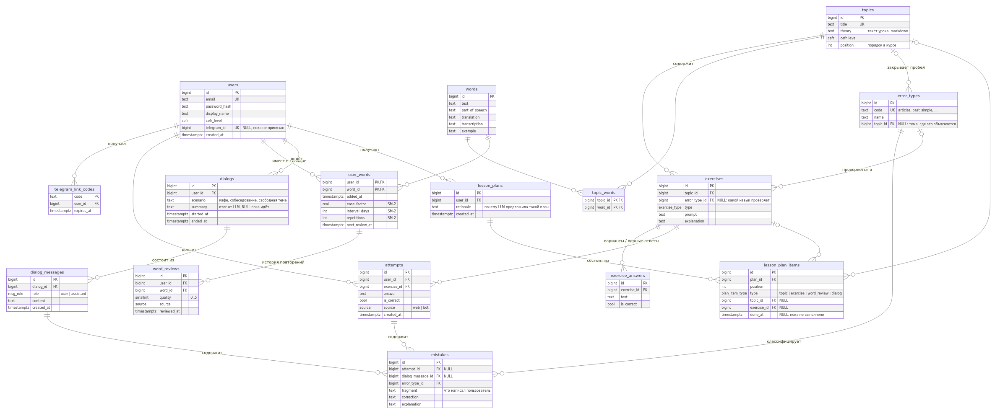

# 3. База данных

СУБД: **PostgreSQL** (реляционная).

Почему реляционная, а не документоориентированная: данные системы сильно связаны (пользователь → попытки → упражнения → темы → типы ошибок), а адаптивное обучение строится на запросах-агрегатах по этим связям («в каких темах у пользователя больше всего ошибок за неделю»). Это естественная задача для SQL с JOIN и GROUP BY. Целостность (нельзя сохранить ответ на несуществующее упражнение) обеспечивают внешние ключи.

## ER-диаграмма



Картинка отражает базовую схему. Актуальная схема, включая учебные сессии, приведена ниже в Mermaid.

```mermaid
erDiagram

    users ||--o{ practice_sessions : "учебные сессии"
    practice_sessions ||--|{ practice_questions : "шаги"
    practice_questions ||--o{ practice_choices : "варианты"
    practice_questions ||--o| practice_answers : "ответ"
    words ||--o{ practice_questions : "личное слово"
    words ||--o{ practice_choices : "вариант перевода"
    practice_sessions {
        bigint id PK
        bigint user_id FK
        text mode
        date practice_date
        timestamptz created_at
        timestamptz completed_at
        timestamptz cancelled_at
    }
    practice_questions {
        bigint session_id PK,FK
        smallint position PK
        bigint word_id FK
        text kind
        text gap_prompt
        timestamptz revealed_at
    }
    practice_choices {
        bigint session_id PK,FK
        smallint position PK,FK
        smallint choice_index PK
        bigint word_id FK
    }
    practice_answers {
        bigint session_id PK,FK
        smallint position PK,FK
        text answer
        smallint option_index FK
        smallint quality
        bool is_correct
        timestamptz next_review_at
        timestamptz created_at
    }
    users ||--o{ telegram_link_codes : "получает"
    users ||--o{ attempts : "делает"
    users ||--o{ user_words : "имеет в словаре"
    users ||--o{ dialogs : "ведёт"
    users ||--o{ lesson_plans : "получает"

    topics ||--o{ exercises : "содержит"
    topics ||--o{ topic_words : ""
    words  ||--o{ topic_words : ""
    topics |o--o{ error_types : "закрывает пробел"

    exercises ||--o{ exercise_answers : "варианты / верные ответы"
    exercises ||--o{ attempts : ""

    attempts ||--o{ mistakes : "содержит"
    dialog_messages ||--o{ mistakes : "содержит"
    error_types ||--o{ mistakes : "классифицирует"
    error_types |o--o{ exercises : "проверяется в"

    words ||--o{ user_words : ""
    user_words ||--o{ word_reviews : "история повторений"

    dialogs ||--o{ dialog_messages : "состоит из"

    lesson_plans ||--o{ lesson_plan_items : "состоит из"
    topics |o--o{ lesson_plan_items : ""
    exercises |o--o{ lesson_plan_items : ""

    users {
        bigint id PK
        text email UK
        text password_hash
        text display_name
        cefr cefr_level
        bigint telegram_id UK "NULL, пока не привязан"
        timestamptz created_at
    }
    telegram_link_codes {
        text code PK
        bigint user_id FK
        timestamptz expires_at
    }
    topics {
        bigint id PK
        text title UK
        text theory "текст урока, markdown"
        cefr cefr_level
        int position "порядок в курсе"
    }
    exercises {
        bigint id PK
        bigint topic_id FK
        bigint error_type_id FK "NULL: какой навык проверяет"
        exercise_type type
        text prompt
        text explanation
    }
    exercise_answers {
        bigint id PK
        bigint exercise_id FK
        text text
        bool is_correct
    }
    error_types {
        bigint id PK
        text code UK "articles, past_simple, ..."
        text name
        bigint topic_id FK "NULL: тема, где это объясняется"
    }
    attempts {
        uuid quiz_request_id UK "NULL для обычных попыток"
        bigint id PK
        bigint user_id FK
        bigint exercise_id FK
        text answer
        bool is_correct
        source source "web | bot"
        timestamptz created_at
    }
    mistakes {
        bigint id PK
        bigint attempt_id FK "NULL"
        bigint dialog_message_id FK "NULL"
        bigint error_type_id FK
        text fragment "что написал пользователь"
        text correction
        text explanation
    }
    words {
        bigint id PK
        text text
        text part_of_speech
        text translation
        text transcription
        text example
    }
    topic_words {
        bigint topic_id PK, FK
        bigint word_id PK, FK
    }
    user_words {
        bigint user_id PK, FK
        bigint word_id PK, FK
        timestamptz added_at
        real ease_factor "SM-2"
        int interval_days "SM-2"
        int repetitions "SM-2"
        timestamptz next_review_at
    }
    word_reviews {
        bigint id PK
        bigint user_id FK
        bigint word_id FK
        smallint quality "0..5"
        source source
        timestamptz reviewed_at
    }
    dialogs {
        bigint id PK
        bigint user_id FK
        text scenario "кафе, собеседование, свободная тема"
        text summary "итог от LLM, NULL пока идёт"
        timestamptz started_at
        timestamptz ended_at
    }
    dialog_messages {
        bigint id PK
        bigint dialog_id FK
        msg_role role "user | assistant"
        text content
        timestamptz created_at
    }
    lesson_plans {
        bigint id PK
        bigint user_id FK
        text rationale "почему LLM предложила такой план"
        timestamptz created_at
    }
    lesson_plan_items {
        bigint id PK
        bigint plan_id FK
        int position
        plan_item_type type "topic | exercise | word_review | dialog"
        bigint topic_id FK "NULL"
        bigint exercise_id FK "NULL"
        text reason "почему наставник предлагает шаг"
        timestamptz done_at "NULL, пока не выполнено"
    }
```

<details>
<summary>Mermaid-код диаграммы</summary>



</details>

Перечисления (`cefr` = A1..C2, `exercise_type`, `source`, `msg_role`, `plan_item_type`) — типы `ENUM` PostgreSQL.

## Таблицы по модулям

| Модуль backend | Таблицы | Назначение |
|---|---|---|
| users | `users`, `telegram_link_codes` | Аккаунты; привязка Telegram одноразовым кодом (`t.me/<bot>?start=<code>`) |
| learning | `topics`, `exercises`, `exercise_answers`, `attempts`, `error_types`, `mistakes` | Контент курса, ответы пользователя и разобранные ошибки |
| vocabulary | `words`, `topic_words`, `user_words`, `word_reviews` | Общий словарь, личный словарь, интервальное повторение |
| vocabulary (практика) | `practice_sessions`, `practice_questions`, `practice_choices`, `practice_answers` | Сохранённые мини-тесты, практика дня и ответы |
| dialogs | `dialogs`, `dialog_messages` | Беседы с Virtual Native Speaker |
| recommendations | `lesson_plans`, `lesson_plan_items` | Персональные планы занятий от адаптивного наставника |

## Ограничения целостности

Кроме первичных и внешних ключей, правила данных проверяет сама СУБД:

| Таблица | Ограничение | Смысл |
|---|---|---|
| `mistakes` | `CHECK (num_nonnulls(attempt_id, dialog_message_id) = 1)` | Ошибка относится ровно к одному источнику |
| `lesson_plan_items` | `CHECK target_matches_type` | Пункт типа `topic` ссылается на тему, `exercise` — на упражнение, остальные — ни на что |
| `word_reviews` | `CHECK (quality BETWEEN 0 AND 5)` | Шкала оценки SM-2 |
| `user_words` | `CHECK (ease_factor >= 1.3)`, неотрицательные интервалы | Корректное состояние SM-2 |
| `dialogs` | `CHECK (ended_at IS NULL OR ended_at >= started_at)` | Диалог не заканчивается раньше начала |
| `words` | `UNIQUE (text, part_of_speech, translation)` | Нет дублей одного значения слова |
| `lesson_plan_items` | `UNIQUE (plan_id, position)` | Порядок пунктов плана однозначен |
| `exercises` | `UNIQUE (topic_id, prompt)` | В теме нет двух одинаковых заданий; это же ключ для повторной загрузки контента |
| `practice_sessions` | Частичный UNIQUE по пользователю и дате для неотменённого дня; CHECK режима и даты | Один действующий набор заданий в день UTC |
| `practice_answers` | PK по сессии и позиции; CHECK ровно одного вида ответа | Один ответ на шаг, безопасный повтор запроса |
| `practice_answers`, `practice_choices` | Составные FK вопроса и варианта | Вариант принадлежит нужному вопросу |
| все enum-поля | `ENUM` PostgreSQL | Например, `source` принимает только `web` / `bot` |

Удаление пользователя каскадно удаляет все его данные (`ON DELETE CASCADE`); удалить тему или упражнение, на которые есть ответы, нельзя (`RESTRICT`) — история обучения не теряется.

Реализация: модели SQLAlchemy в `backend/app/modules/*/models.py`, миграция — `backend/migrations/versions/`.

## Ключевые проектные решения

- **Один `exercise_answers` для всех типов упражнений.** Для упражнений с выбором это показываемые варианты (`is_correct` отмечает верный). Для упражнений с вводом это список принимаемых верных ответов («don't» и «do not»). Так нет дублирования верного ответа в двух местах.
- **Ошибки из упражнений и из диалогов — в одной таблице `mistakes`.** Ровно одно из полей `attempt_id` / `dialog_message_id` заполнено: `CHECK (num_nonnulls(attempt_id, dialog_message_id) = 1)`. Благодаря этому адаптивный наставник анализирует все ошибки пользователя одним запросом.
- **`exercises.error_type_id`** — какой навык проверяет упражнение: неверный ответ сразу записывается в `mistakes` как ошибка этого типа. Это не дублирует `error_types.topic_id`: там — где навык *объясняется*, здесь — где он *проверяется*.
- **`error_types.topic_id`** связывает тип ошибки с темой, где он объясняется. Отсюда рекомендация: «много ошибок `articles` → повторить тему "Articles"».
- **`user_words` хранит состояние алгоритма SM-2**, а `word_reviews` — полную историю повторений. Бот выбирает слова запросом `WHERE next_review_at <= now()`.
- **Сайт и бот пишут в одни таблицы**, различие только в поле `source`. Это и есть «одна система».

## Нормализация до 3НФ

**1НФ — все значения атомарны, нет повторяющихся групп.**
Варианты ответа не хранятся строкой «a;b;c» в `exercises`, а вынесены в `exercise_answers`. Слова темы — не массив в `topics`, а связующая таблица `topic_words`. Сообщения диалога — отдельные строки `dialog_messages`, а не один JSON.

**2НФ — 1НФ + нет зависимости неключевых атрибутов от части составного ключа.**
Составные ключи есть у `topic_words (topic_id, word_id)` и `user_words (user_id, word_id)`. В `user_words` все атрибуты (`added_at`, параметры SM-2, `next_review_at`) описывают именно пару «пользователь—слово». Перевод и транскрипция зависят только от `word_id`, поэтому лежат в `words`, а не в `user_words`.

**3НФ — 2НФ + нет транзитивных зависимостей (неключевой атрибут → неключевой атрибут).**
Нарушения, которых мы сознательно избежали:

| Соблазн | Транзитивная зависимость | Как сделано |
|---|---|---|
| `mistakes.user_id` | `mistake → attempt → user` | Пользователь получается через JOIN с `attempts` / `dialog_messages → dialogs` |
| `exercises.cefr_level` | `exercise → topic → cefr_level` | Уровень берётся из темы |
| `dialog_messages.user_id` | `message → dialog → user` | Через `dialogs` |
| `mistakes.created_at` | `mistake → attempt → created_at` | Время берётся из попытки или сообщения |
| `attempts.topic_id` | `attempt → exercise → topic` | Через `exercises` |
| `users.progress_percent`, `users.streak_days` | вычисляется из `attempts` | Не хранится, считается запросом |

**Обоснованные исключения:**

- `attempts.is_correct` формально можно вычислить из `answer` и `exercise_answers`. Но это факт оценки в момент ответа: свободные ответы оценивает LLM, и результат не воспроизводится детерминированно. Кроме того, исправление верных ответов не должно менять историю.
- Параметры SM-2 в `user_words` можно пересчитать из `word_reviews`, но это состояние алгоритма. Его хранят ради быстрого запроса «что повторять сегодня». Ни одна функциональная зависимость между неключевыми атрибутами при этом не нарушается.

## Примеры запросов для адаптивности

Слабые места пользователя за последние 14 дней (вход для LLM-наставника):

```sql
SELECT et.code, et.name, t.title AS topic_to_review, count(*) AS mistakes
FROM mistakes m
JOIN error_types et ON et.id = m.error_type_id
LEFT JOIN topics t ON t.id = et.topic_id
LEFT JOIN attempts a ON a.id = m.attempt_id
LEFT JOIN dialog_messages dm ON dm.id = m.dialog_message_id
LEFT JOIN dialogs d ON d.id = dm.dialog_id
WHERE coalesce(a.user_id, d.user_id) = :user_id
  AND coalesce(a.created_at, dm.created_at) > now() - interval '14 days'
GROUP BY et.code, et.name, t.title
ORDER BY mistakes DESC
LIMIT 5;
```

Прогресс по темам (вычисляется, а не хранится):

```sql
SELECT t.title,
       count(DISTINCT e.id) AS total_exercises,
       count(DISTINCT a.exercise_id) FILTER (WHERE a.is_correct) AS solved
FROM topics t
JOIN exercises e ON e.topic_id = t.id
LEFT JOIN attempts a ON a.exercise_id = e.id AND a.user_id = :user_id
GROUP BY t.id
ORDER BY t.position;
```

Слова на повторение в боте:

```sql
SELECT w.text, w.translation
FROM user_words uw JOIN words w ON w.id = uw.word_id
WHERE uw.user_id = :user_id AND uw.next_review_at <= now()
ORDER BY uw.next_review_at
LIMIT 20;
```


## Учебные сессии подключённого бота

Модели: vocabulary/practice_models.py; добавочная миграция feef7ec67795.
Данные словаря и существующие таблицы не перестраиваются.

- practice_sessions: владелец, режим, дата UTC и события завершения/отмены.
  Частичный уникальный индекс запрещает вторую неотменённую дневную сессию пользователя
  за ту же дату. Режим и наличие даты согласованы CHECK.
- practice_questions: составной ключ (session_id, position), слово и вид шага.
- practice_choices: отдельные атомарные варианты, ключ (session_id, position, choice_index).
  Переводы берутся из words, в вопросах не дублируются.
- practice_answers: один ответ на шаг. Владелец определяется через сессию;
  дублирующего user_id нет. CHECK требует ровно одно из answer, option_index, quality.
  is_correct не заполняется для самооценок карточек.
- Составные внешние ключи защищают принадлежность вопроса и выбранного варианта.
  Удаление пользователя каскадно удаляет его сессии; общие слова защищены RESTRICT.
  Удаление слова только из личного словаря сохраняет результаты прошлых тестов.
- Правильность ответа — исторический результат проверки, как в attempts.
  next_review_at в ответе — квитанция о времени, назначенном в момент ответа,
  а не дубликат текущего состояния SM-2. gap_prompt — снимок использованного примера.
- Счётчики правильных ответов, повторений и завершённых занятий не хранятся в профиле:
  они вычисляются запросами. Показатель reviews относится к сохранённой истории повторений.
- Блокировка сессии и единая транзакция ответа со SM-2 предотвращают повторное
  начисление результата. Блокировка пользователя и уникальный индекс защищают создание дня.


## Идемпотентность грамматического мини-теста

Миграция `43519f5b65f9` добавляет к `attempts` одно nullable-поле UUID
`quiz_request_id` и уникальное ограничение `uq_attempts_quiz_request_id`.
Существующие строки сохраняются; NULL допускается многократно для обычных попыток
сайта. Пользователи, словари, привязки, результаты и таблицы практики не удаляются.

Идентификатор получается на сервере из подписанного номера теста и позиции задания.
Транзакционная advisory-блокировка PostgreSQL сериализует ответы одного теста;
уникальность защищает от повторной записи. Повтор того же ответа возвращает результат
существующей попытки; другой ответ на пройденный шаг отклоняется. Проверка и запись
используют общий `learning.service.submit_attempt`, включая `mistakes`.

Отдельного банка, копии ответов и таблицы итогов теста нет. Балл и темы ошибок
вычисляются из `attempts` и связей exercises/topics: требования 3НФ сохраняются.
Служебный токен API не хранится в учебных таблицах. Подписанный токен теста ограничен
пользователем и сроком четыре часа, передаётся только телом HTTP-запроса/ответа.
Он не является токеном входа сайта и подписан отдельным производным ключом.

Upgrade, downgrade до `feef7ec67795`, повторный upgrade и `alembic check` проверены
на временной PostgreSQL. Downgrade удаляет только новое ограничение и колонку;
на рабочей базе downgrade не выполнялся. Ручная проверка схемы: внешние ключи
attempts/mistakes сохранены, новая уникальность относится к одной попытке,
производные итоговые значения не записываются.
