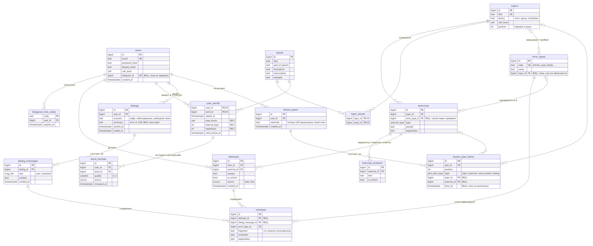
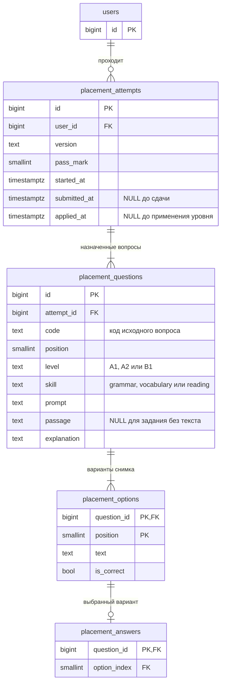
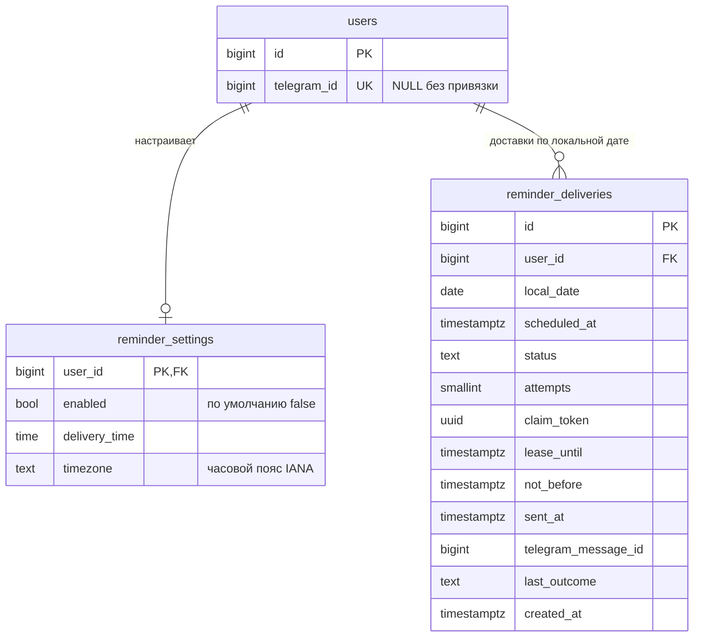
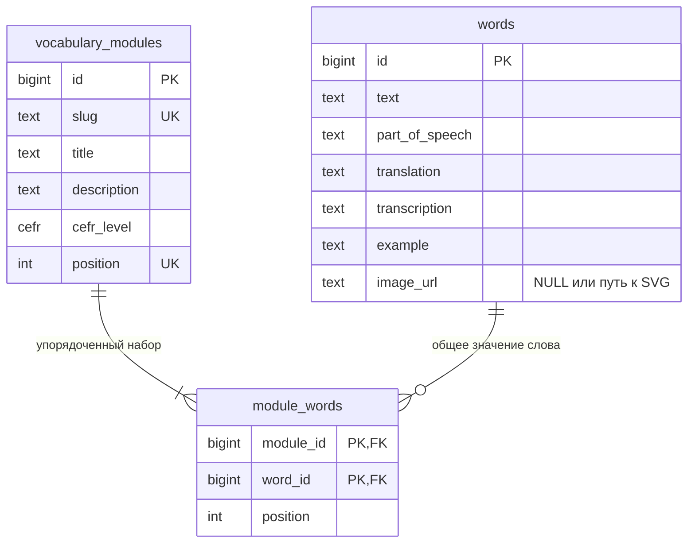

# 3. База данных

СУБД: **PostgreSQL** (реляционная).

Почему реляционная, а не документоориентированная: данные системы сильно связаны (пользователь → попытки → упражнения → темы → типы ошибок), а адаптивное обучение строится на запросах-агрегатах по этим связям («в каких темах у пользователя больше всего ошибок за неделю»). Это естественная задача для SQL с JOIN и GROUP BY. Целостность (нельзя сохранить ответ на несуществующее упражнение) обеспечивают внешние ключи.

## ER-диаграмма



Картинка отражает базовую схему. Актуальная схема приведена ниже в Mermaid:
первая диаграмма показывает исходные модули и учебные сессии, следующие три —
диагностику уровня, напоминания и тематический словарь. Общие `users` и `words`
повторяются в отдельных диаграммах для обозначения связей, а не как новые таблицы.

```mermaid
erDiagram

    users ||--o{ practice_sessions : "учебные сессии"
    practice_sessions ||--|{ practice_questions : "шаги"
    practice_questions ||--o{ practice_choices : "варианты"
    practice_questions ||--o| practice_answers : "ответ"
    words ||--o{ practice_questions : "личное слово"
    words ||--o{ practice_choices : "вариант перевода"
    practice_sessions {
        bigint id PK
        bigint user_id FK
        text mode
        date practice_date
        timestamptz created_at
        timestamptz completed_at
        timestamptz cancelled_at
    }
    practice_questions {
        bigint session_id PK,FK
        smallint position PK
        bigint word_id FK
        text kind
        text gap_prompt
        timestamptz revealed_at
    }
    practice_choices {
        bigint session_id PK,FK
        smallint position PK,FK
        smallint choice_index PK
        bigint word_id FK
    }
    practice_answers {
        bigint session_id PK,FK
        smallint position PK,FK
        text answer
        smallint option_index FK
        smallint quality
        bool is_correct
        timestamptz next_review_at
        timestamptz created_at
    }
    users ||--o{ telegram_link_codes : "получает"
    users ||--o{ attempts : "делает"
    users ||--o{ user_words : "имеет в словаре"
    users ||--o{ dialogs : "ведёт"
    users ||--o{ lesson_plans : "получает"

    topics ||--o{ exercises : "содержит"
    topics ||--o{ topic_words : ""
    words  ||--o{ topic_words : ""
    topics |o--o{ error_types : "закрывает пробел"

    exercises ||--o{ exercise_answers : "варианты / верные ответы"
    exercises ||--o{ attempts : ""

    attempts ||--o{ mistakes : "содержит"
    dialog_messages ||--o{ mistakes : "содержит"
    error_types ||--o{ mistakes : "классифицирует"
    error_types |o--o{ exercises : "проверяется в"

    words ||--o{ user_words : ""
    user_words ||--o{ word_reviews : "история повторений"

    dialogs ||--o{ dialog_messages : "состоит из"

    lesson_plans ||--o{ lesson_plan_items : "состоит из"
    topics |o--o{ lesson_plan_items : ""
    exercises |o--o{ lesson_plan_items : ""

    users {
        bigint id PK
        text email UK
        text password_hash
        text display_name
        cefr cefr_level
        bigint telegram_id UK "NULL, пока не привязан"
        timestamptz created_at
    }
    telegram_link_codes {
        text code PK
        bigint user_id FK
        timestamptz expires_at
    }
    topics {
        bigint id PK
        text title UK
        text theory "текст урока, markdown"
        cefr cefr_level
        int position "порядок в курсе"
    }
    exercises {
        bigint id PK
        bigint topic_id FK
        bigint error_type_id FK "NULL: какой навык проверяет"
        exercise_type type
        text prompt
        text explanation
    }
    exercise_answers {
        bigint id PK
        bigint exercise_id FK
        text text
        bool is_correct
    }
    error_types {
        bigint id PK
        text code UK "articles, past_simple, ..."
        text name
        bigint topic_id FK "NULL: тема, где это объясняется"
    }
    attempts {
        uuid quiz_request_id UK "NULL для обычных попыток"
        bigint id PK
        bigint user_id FK
        bigint exercise_id FK
        text answer
        bool is_correct
        source source "web | bot"
        timestamptz created_at
    }
    mistakes {
        bigint id PK
        bigint attempt_id FK "NULL"
        bigint dialog_message_id FK "NULL"
        bigint error_type_id FK
        text fragment "что написал пользователь"
        text correction
        text explanation
    }
    words {
        bigint id PK
        text text
        text part_of_speech
        text translation
        text transcription
        text example
        text image_url "NULL или локальная SVG-иллюстрация"
    }
    topic_words {
        bigint topic_id PK, FK
        bigint word_id PK, FK
    }
    user_words {
        bigint user_id PK, FK
        bigint word_id PK, FK
        timestamptz added_at
        real ease_factor "SM-2"
        int interval_days "SM-2"
        int repetitions "SM-2"
        timestamptz next_review_at
    }
    word_reviews {
        bigint id PK
        bigint user_id FK
        bigint word_id FK
        smallint quality "0..5"
        source source
        timestamptz reviewed_at
    }
    dialogs {
        bigint id PK
        bigint user_id FK
        text scenario "кафе, собеседование, свободная тема"
        text summary "итог от LLM, NULL пока идёт"
        timestamptz started_at
        timestamptz ended_at
    }
    dialog_messages {
        bigint id PK
        bigint dialog_id FK
        msg_role role "user | assistant"
        text content
        timestamptz created_at
    }
    lesson_plans {
        bigint id PK
        bigint user_id FK
        text rationale "почему LLM предложила такой план"
        timestamptz created_at
    }
    lesson_plan_items {
        bigint id PK
        bigint plan_id FK
        int position
        plan_item_type type "topic | exercise | word_review | dialog"
        bigint topic_id FK "NULL"
        bigint exercise_id FK "NULL"
        text reason "почему наставник предлагает шаг"
        timestamptz done_at "NULL, пока не выполнено"
    }
```

<details>
<summary>Mermaid-код диаграммы</summary>



</details>

### Диагностика стартового уровня



FK из `placement_answers (question_id, option_index)` ссылается на составной
ключ `placement_options (question_id, position)`. PK только по `question_id`
разрешает один выбранный вариант на вопрос. Владелец и попытка определяются
через вопрос; отдельные `user_id` и `attempt_id` в ответе не дублируются.

### Настройки и доставка напоминаний



Настройки и доставки ссылаются непосредственно на пользователя. Доставка —
отдельный факт за локальную дату: изменение времени или часового пояса в
`reminder_settings` не должно переписывать уже выполненные доставки.

### Тематические модули словаря



Модуль словаря существует отдельно от грамматической темы. Одно значение слова
может входить в несколько модулей и тем; перевод, пример и иллюстрация хранятся
в единственной строке `words`. Персональное состояние этого слова по-прежнему
хранится только в `user_words`.

Перечисления (`cefr` = A1..C2, `exercise_type`, `source`, `msg_role`, `plan_item_type`) — типы `ENUM` PostgreSQL.
В новых таблицах диагностики и напоминаний допустимые текстовые значения
защищены CHECK. `vocabulary_modules.cefr_level` переиспользует существующий
PostgreSQL ENUM `cefr_level`; отдельный тип для модулей не создаётся.

## Таблицы по модулям

| Модуль backend | Таблицы | Назначение |
|---|---|---|
| users | `users`, `telegram_link_codes` | Аккаунты; привязка Telegram одноразовым кодом (`t.me/<bot>?start=<code>`) |
| learning | `topics`, `exercises`, `exercise_answers`, `attempts`, `error_types`, `mistakes` | Контент курса, ответы пользователя и разобранные ошибки |
| vocabulary | `words`, `topic_words`, `user_words`, `word_reviews` | Общий словарь, личный словарь, интервальное повторение |
| vocabulary (практика) | `practice_sessions`, `practice_questions`, `practice_choices`, `practice_answers` | Сохранённые мини-тесты, практика дня и ответы |
| vocabulary (модули) | `vocabulary_modules`, `module_words` | Тематические наборы общих слов; порядок карточек и добавление в личный словарь |
| placement | `placement_attempts`, `placement_questions`, `placement_options`, `placement_answers` | Снимки диагностических тестов A1–B1, ответы и история применения уровня |
| reminders | `reminder_settings`, `reminder_deliveries` | Добровольные настройки Telegram-напоминаний и состояние их доставки |
| dialogs | `dialogs`, `dialog_messages` | Беседы с Virtual Native Speaker |
| recommendations | `lesson_plans`, `lesson_plan_items` | Персональные планы занятий от адаптивного наставника |

## Ограничения целостности

Кроме первичных и внешних ключей, правила данных проверяет сама СУБД:

| Таблица | Ограничение | Смысл |
|---|---|---|
| `mistakes` | `CHECK (num_nonnulls(attempt_id, dialog_message_id) = 1)` | Ошибка относится ровно к одному источнику |
| `lesson_plan_items` | `CHECK target_matches_type` | Пункт типа `topic` ссылается на тему, `exercise` — на упражнение, остальные — ни на что |
| `word_reviews` | `CHECK (quality BETWEEN 0 AND 5)` | Шкала оценки SM-2 |
| `user_words` | `CHECK (ease_factor >= 1.3)`, неотрицательные интервалы | Корректное состояние SM-2 |
| `dialogs` | `CHECK (ended_at IS NULL OR ended_at >= started_at)` | Диалог не заканчивается раньше начала |
| `words` | `UNIQUE (text, part_of_speech, translation)` | Нет дублей одного значения слова |
| `words` | `CHECK local_image_url`: NULL либо путь вида `/images/vocabulary/<slug>.svg` | Иллюстрация хранится как локальный путь; произвольные URL и обход каталогов не принимаются |
| `lesson_plan_items` | `UNIQUE (plan_id, position)` | Порядок пунктов плана однозначен |
| `exercises` | `UNIQUE (topic_id, prompt)` | В теме нет двух одинаковых заданий; это же ключ для повторной загрузки контента |
| `practice_sessions` | Частичный UNIQUE по пользователю и дате для неотменённого дня; CHECK режима и даты | Один действующий набор заданий в день UTC |
| `practice_answers` | PK по сессии и позиции; CHECK ровно одного вида ответа | Один ответ на шаг, безопасный повтор запроса |
| `practice_answers`, `practice_choices` | Составные FK вопроса и варианта | Вариант принадлежит нужному вопросу |
| `vocabulary_modules` | UNIQUE по `slug` и по `position`; `CHECK (position > 0)` | Уникальные адрес и место модуля в каталоге |
| `module_words` | PK `(module_id, word_id)`; `UNIQUE (module_id, position)`; `CHECK (position > 0)` | Нет повторного слова или двух карточек на одной позиции внутри модуля |
| `module_words` | FK на модуль и общее слово, оба `ON DELETE CASCADE` | При удалении объекта удаляется его принадлежность модулю |
| `placement_attempts` | `CHECK (pass_mark BETWEEN 1 AND 8)` | Допустимый сохранённый порог блока из восьми заданий |
| `placement_attempts` | `CHECK (applied_at IS NULL OR submitted_at IS NOT NULL)` | Нельзя отметить применение несданного результата |
| `placement_questions` | UNIQUE `(attempt_id, code)` и `(attempt_id, position)` | Код и порядковый номер вопроса уникальны внутри попытки |
| `placement_questions` | CHECK позиции 1–24, уровня A1/A2/B1 и навыка grammar/vocabulary/reading | Допустимые атрибуты назначенного задания |
| `placement_options` | PK `(question_id, position)`; CHECK позиции 0–3 | Один вариант на позицию внутри вопроса |
| `placement_options` | Частичный UNIQUE по `question_id WHERE is_correct` | Не более одного правильного варианта на вопрос |
| `placement_answers` | PK `question_id`; составной FK `(question_id, option_index)` | Один ответ на вопрос; выбранный вариант обязательно принадлежит этому вопросу |
| `reminder_settings` | PK/FK `user_id`; `enabled NOT NULL DEFAULT false` | Одни настройки на пользователя; доставка выключена до явного включения |
| `reminder_deliveries` | `UNIQUE (user_id, local_date)` | Одна запись доставки на пользователя и локальный календарный день |
| `reminder_deliveries` | CHECK статуса pending/claimed/sent/failed/cancelled | Разрешённые состояния доставки |
| `reminder_deliveries` | `CHECK (attempts BETWEEN 0 AND 3)` | Ограничение числа попыток отправки одной доставки |
| `reminder_deliveries` | CHECK: для claimed заполнены `claim_token` и `lease_until`; для остальных `lease_until IS NULL` | Активная аренда имеет токен и срок; завершённая аренда снята |
| все enum-поля | `ENUM` PostgreSQL | Например, `source` принимает только `web` / `bot` |

Удаление пользователя каскадно удаляет все его данные (`ON DELETE CASCADE`); удалить тему или упражнение, на которые есть ответы, нельзя (`RESTRICT`) — история обучения не теряется.

Для диагностики каскад проходит по цепочке «пользователь → попытка → вопросы →
варианты → ответы». Запись ответа не может пережить удаление своего варианта.
Настройки и доставки напоминаний также удаляются вместе с пользователем.
Удаление каталожной связи `module_words` не удаляет `Word`, личный словарь и
историю SM-2; при повторной загрузке контента заменяются только эти связи.

Некоторые правила проверяет приложение, а не отдельный SQL CHECK. Загрузчик
диагностики проверяет ровно 24 вопроса, по восемь на уровень, четыре различных
варианта и ровно один правильный на вопрос. API требует полный набор из 24
неповторяющихся ответов своей попытки. Часовой пояс напоминаний проверяется
через `ZoneInfo`, время — форматом `HH:MM`; включение требует привязанного Telegram.
Отсутствие `reminder_settings` интерпретируется как выключенная доставка с
начальными настройками 19:00, Europe/Moscow.

Реализация: модели SQLAlchemy в `backend/app/modules/*/models.py` и
`backend/app/modules/vocabulary/{practice_models,modules_models}.py`, миграции —
`backend/migrations/versions/`. Все модели зарегистрированы в `backend/app/models.py`.

## Ключевые проектные решения

- **Один `exercise_answers` для всех типов упражнений.** Для упражнений с выбором это показываемые варианты (`is_correct` отмечает верный). Для упражнений с вводом это список принимаемых верных ответов («don't» и «do not»). Так нет дублирования верного ответа в двух местах.
- **Ошибки из упражнений и из диалогов — в одной таблице `mistakes`.** Ровно одно из полей `attempt_id` / `dialog_message_id` заполнено: `CHECK (num_nonnulls(attempt_id, dialog_message_id) = 1)`. Благодаря этому адаптивный наставник анализирует все ошибки пользователя одним запросом.
- **`exercises.error_type_id`** — какой навык проверяет упражнение: неверный ответ сразу записывается в `mistakes` как ошибка этого типа. Это не дублирует `error_types.topic_id`: там — где навык *объясняется*, здесь — где он *проверяется*.
- **`error_types.topic_id`** связывает тип ошибки с темой, где он объясняется. Отсюда рекомендация: «много ошибок `articles` → повторить тему "Articles"».
- **`user_words` хранит состояние алгоритма SM-2**, а `word_reviews` — полную историю повторений. Бот выбирает слова запросом `WHERE next_review_at <= now()`.
- **Сайт и бот пишут в одни таблицы**, различие только в поле `source`. Это и есть «одна система».
- **Лексические модули используют общий словарь.** Добавление модуля выполняет
  `INSERT ... ON CONFLICT DO NOTHING` в `user_words`. Уже существующие интервалы,
  даты повторения и оценки не сбрасываются.
- **Диагностика хранит назначенный контент.** Вопросы и варианты копируются из
  версионного банка при начале попытки. Баллы вычисляются по этому снимку, поэтому
  последующее редактирование исходного JSON не меняет старый результат.
- **Применение уровня — отдельное действие.** Сдача диагностики сохраняет ответы;
  только `/placement/attempts/{id}/apply` атомарно обновляет общий `users.cefr_level`
  и время `applied_at`. Это позволяет сначала изучить результат и его ограничения.
- **Доставкой напоминаний управляет backend.** База хранит расписание и аренду;
  бот получает подтверждённого получателя через служебный API. Секреты входа бота
  в таблицах не хранятся. `claim_token` — случайный идентификатор отдельной аренды.

## Нормализация до 3НФ

**1НФ — все значения атомарны, нет повторяющихся групп.**
Варианты ответа не хранятся строкой «a;b;c» в `exercises`, а вынесены в `exercise_answers`. Слова темы — не массив в `topics`, а связующая таблица `topic_words`. Сообщения диалога — отдельные строки `dialog_messages`, а не один JSON.
Так же устроены `module_words` и диагностические `placement_options`: список
слов или вариантов не записывается JSON-массивом в родительскую строку.

**2НФ — 1НФ + нет зависимости неключевых атрибутов от части составного ключа.**
Составные ключи есть у `topic_words (topic_id, word_id)` и `user_words (user_id, word_id)`. В `user_words` все атрибуты (`added_at`, параметры SM-2, `next_review_at`) описывают именно пару «пользователь—слово». Перевод и транскрипция зависят только от `word_id`, поэтому лежат в `words`, а не в `user_words`.
В `module_words (module_id, word_id)` позиция описывает слово именно в данном
модуле. Текст и правильность варианта диагностики зависят от полного ключа
`placement_options (question_id, position)`.

**3НФ — 2НФ + нет транзитивных зависимостей (неключевой атрибут → неключевой атрибут).**
Нарушения, которых мы сознательно избежали:

| Соблазн | Транзитивная зависимость | Как сделано |
|---|---|---|
| `mistakes.user_id` | `mistake → attempt → user` | Пользователь получается через JOIN с `attempts` / `dialog_messages → dialogs` |
| `exercises.cefr_level` | `exercise → topic → cefr_level` | Уровень берётся из темы |
| `dialog_messages.user_id` | `message → dialog → user` | Через `dialogs` |
| `mistakes.created_at` | `mistake → attempt → created_at` | Время берётся из попытки или сообщения |
| `attempts.topic_id` | `attempt → exercise → topic` | Через `exercises` |
| `users.progress_percent`, `users.streak_days` | вычисляется из `attempts` | Не хранится, считается запросом |
| `placement_answers.user_id`, `placement_answers.attempt_id` | `answer → question → attempt → user` | Владелец и попытка получаются через связи назначенного вопроса |
| Баллы и рекомендованный уровень в `placement_attempts` | Вычисляются из выбранных вариантов и сохранённого порога | Считаются сервисом; отдельные итоговые колонки отсутствуют |
| Перевод или иллюстрация в `module_words` / `user_words` | `membership → word → translation/image_url` | Хранятся в `words` и читаются через JOIN |
| Число слов и число добавленных карточек в `vocabulary_modules` | Вычисляются из `module_words` и `user_words` | Агрегаты ответа API, а не поля модели |

**Обоснованные исключения:**

- `attempts.is_correct` формально можно вычислить из `answer` и `exercise_answers`.
  Но это факт оценки в момент ответа: исправление верных ответов не должно менять
  историю. В текущих учебных упражнениях проверка детерминированная; ошибки в
  свободных репликах диалогов оценивает LLM и сохраняет отдельно в `mistakes`.
- Параметры SM-2 в `user_words` можно пересчитать из `word_reviews`, но это состояние алгоритма. Его хранят ради быстрого запроса «что повторять сегодня». Ни одна функциональная зависимость между неключевыми атрибутами при этом не нарушается.
- **Снимок диагностики — осознанное повторение исходного каталога ради истории.**
  Одинаковый текст может быть назначен разным попыткам. `version` и `code` описывают
  источник, но не являются внешним ключом на изменяемый файл контента. Сохраняются
  фактически назначенные формулировки, правильные варианты и порог, а не только
  ссылка на текущую версию банка. Такая избыточность изолирована в снимках; выбранные
  ответы и вычисляемые итоги не дублируются. Для будущего изменения правила оценки
  нужно сохранить поддержку алгоритма старой версии, а не переоценивать историю.
- **Состояние доставки является операционным состоянием задания.** `status`,
  `attempts`, `lease_until`, `not_before` и последний исход нужны для захвата,
  подтверждения и повторной отправки. Это не учебные счётчики пользователя.
  `scheduled_at` и `local_date` фиксируют конкретную доставку и не пересчитываются
  из текущих настроек после их изменения. Время следующей попытки может зависеть
  от ответа Telegram `retry_after`, поэтому не определяется одним расписанием.

## Примеры запросов для адаптивности

Слабые места пользователя за последние 14 дней (вход для LLM-наставника):

```sql
SELECT et.code, et.name, t.title AS topic_to_review, count(*) AS mistakes
FROM mistakes m
JOIN error_types et ON et.id = m.error_type_id
LEFT JOIN topics t ON t.id = et.topic_id
LEFT JOIN attempts a ON a.id = m.attempt_id
LEFT JOIN dialog_messages dm ON dm.id = m.dialog_message_id
LEFT JOIN dialogs d ON d.id = dm.dialog_id
WHERE coalesce(a.user_id, d.user_id) = :user_id
  AND coalesce(a.created_at, dm.created_at) > now() - interval '14 days'
GROUP BY et.code, et.name, t.title
ORDER BY mistakes DESC
LIMIT 5;
```

Прогресс по темам (вычисляется, а не хранится):

```sql
SELECT t.title,
       count(DISTINCT e.id) AS total_exercises,
       count(DISTINCT a.exercise_id) FILTER (WHERE a.is_correct) AS solved
FROM topics t
JOIN exercises e ON e.topic_id = t.id
LEFT JOIN attempts a ON a.exercise_id = e.id AND a.user_id = :user_id
GROUP BY t.id
ORDER BY t.position;
```

Слова на повторение в боте:

```sql
SELECT w.text, w.translation
FROM user_words uw JOIN words w ON w.id = uw.word_id
WHERE uw.user_id = :user_id AND uw.next_review_at <= now()
ORDER BY uw.next_review_at
LIMIT 20;
```


## Учебные сессии подключённого бота

Модели: vocabulary/practice_models.py; добавочная миграция feef7ec67795.
Данные словаря и существующие таблицы не перестраиваются.

- practice_sessions: владелец, режим, дата UTC и события завершения/отмены.
  Частичный уникальный индекс запрещает вторую неотменённую дневную сессию пользователя
  за ту же дату. Режим и наличие даты согласованы CHECK.
- practice_questions: составной ключ (session_id, position), слово и вид шага.
- practice_choices: отдельные атомарные варианты, ключ (session_id, position, choice_index).
  Переводы берутся из words, в вопросах не дублируются.
- practice_answers: один ответ на шаг. Владелец определяется через сессию;
  дублирующего user_id нет. CHECK требует ровно одно из answer, option_index, quality.
  is_correct не заполняется для самооценок карточек.
- Составные внешние ключи защищают принадлежность вопроса и выбранного варианта.
  Удаление пользователя каскадно удаляет его сессии; общие слова защищены RESTRICT.
  Удаление слова только из личного словаря сохраняет результаты прошлых тестов.
- Правильность ответа — исторический результат проверки, как в attempts.
  next_review_at в ответе — квитанция о времени, назначенном в момент ответа,
  а не дубликат текущего состояния SM-2. gap_prompt — снимок использованного примера.
- Счётчики правильных ответов, повторений и завершённых занятий не хранятся в профиле:
  они вычисляются запросами. Показатель reviews относится к сохранённой истории повторений.
- Блокировка сессии и единая транзакция ответа со SM-2 предотвращают повторное
  начисление результата. Блокировка пользователя и уникальный индекс защищают создание дня.


## Идемпотентность грамматического мини-теста

Миграция `43519f5b65f9` добавляет к `attempts` одно nullable-поле UUID
`quiz_request_id` и уникальное ограничение `uq_attempts_quiz_request_id`.
Существующие строки сохраняются; NULL допускается многократно для обычных попыток
сайта. Пользователи, словари, привязки, результаты и таблицы практики не удаляются.

Идентификатор получается на сервере из подписанного номера теста и позиции задания.
Транзакционная advisory-блокировка PostgreSQL сериализует ответы одного теста;
уникальность защищает от повторной записи. Повтор того же ответа возвращает результат
существующей попытки; другой ответ на пройденный шаг отклоняется. Проверка и запись
используют общий `learning.service.submit_attempt`, включая `mistakes`.

Отдельного банка, копии ответов и таблицы итогов теста нет. Балл и темы ошибок
вычисляются из `attempts` и связей exercises/topics: требования 3НФ сохраняются.
Служебный токен API не хранится в учебных таблицах. Подписанный токен теста ограничен
пользователем и сроком четыре часа, передаётся только телом HTTP-запроса/ответа.
Он не является токеном входа сайта и подписан отдельным производным ключом.

Upgrade, downgrade до `feef7ec67795`, повторный upgrade и `alembic check` проверены
на временной PostgreSQL. Downgrade удаляет только новое ограничение и колонку;
на рабочей базе downgrade не выполнялся. Ручная проверка схемы: внешние ключи
attempts/mistakes сохранены, новая уникальность относится к одной попытке,
производные итоговые значения не записываются.

## Диагностика A1–B1: снимок, оценка и применение

Миграция `a26111200001` после `43519f5b65f9` добавляет четыре таблицы
`placement_attempts`, `placement_questions`, `placement_options`, `placement_answers`.
Она не изменяет прежние упражнения, оценки, словари или привязки пользователя.

Банк `backend/content/placement.json` содержит 24 вопроса. При начале попытки
в одной транзакции сохраняются её версия, порог и назначенные вопросы с вариантами.
Идентификатор назначенного вопроса отличается от кода в JSON и от идентификатора
аналогичного вопроса в другой попытке. До сдачи API возвращает только формулировки,
тексты для чтения и варианты; ключи правильности и объяснения остаются на сервере.

При сдаче сервер блокирует строку попытки через `SELECT ... FOR UPDATE`, проверяет
полный набор ответов и записывает выбранные варианты вместе с `submitted_at`.
Повторная отправка тех же ответов возвращает существующий результат. Изменённый
набор после завершения отклоняется; попытка другого пользователя недоступна.
PK по вопросу дополнительно защищает от повторной записи на уровне БД.

Балл уровня — число выбранных правильных вариантов в соответствующих восьми
вопросах. В текущей версии рекомендуемый уровень ограничен A1–B1: порог составляет
6 из 8 в каждом последовательно пройденном блоке. Тест не является сертификацией
CEFR и не проверяет говорение или аудирование. Подробный контракт и ограничения
описаны в [placement.md](placement.md).

`applied_at` хранит факт отдельного применения результата. Операция блокирует
попытку и пользователя, вызывает `users.service.set_level(..., commit=False)`
и коммитит изменение профиля вместе с отметкой применения. Повторное применение
уже отмеченной попытки не перезаписывает уровень, который мог быть изменён позднее.
Индекс `(user_id, started_at)` поддерживает выборку собственной истории.

## Напоминания: расписание и состояние доставки

Миграция `a26111200002` после `a26111200001` добавляет `reminder_settings`
и `reminder_deliveries`. Напоминания изначально выключены. Пользователь сайта
или привязанный Telegram-пользователь меняет только собственные настройки;
получать задания для отправки и подтверждать их может только служебный клиент бота.

Часовой пояс хранится как IANA-имя, время — как локальное время суток без смещения.
Backend переводит выбранную дату и время в UTC. При осеннем повторе локального
времени используется первое вхождение, при весеннем пропуске времени доставка
в этот момент не создаётся. Окно догоняющей отправки — один час, включая переход
через местную полночь; старые дни не воспроизводятся пачкой.

Выдача задания блокирует настройки с `FOR UPDATE SKIP LOCKED`, затем строку
доставки. UNIQUE `(user_id, local_date)` не допускает второй записи доставки
за день. Состояние `claimed` получает случайный UUID `claim_token` и аренду
на три минуты; подтверждение со старым токеном после нового захвата отклоняется.
Повтор того же подтверждения идемпотентен. Временные ошибки допускают не более
трёх попыток, с задержкой и учётом `retry_after`; запрет доставки со стороны
Telegram выключает напоминания. Индекс `(status, not_before)` предусмотрен для
операций с очередью.

Изменение настроек отменяет ожидающие доставки и активные аренды; обработка
блокирует настройки перед доставками, сохраняя единый порядок блокировок.
Смена расписания не создаёт вторую запись за уже занятый локальный день.
Запрос к Telegram, который уже начался, может успеть завершиться после отключения.
Позднее подтверждение такой успешной отправки сохраняется как `sent`, не включая
настройки обратно.

Сетевая отправка Telegram и транзакция PostgreSQL не образуют общую атомарную
операцию. Worker сохраняет квитанцию в памяти до подтверждения и при сбое ACK
не повторяет уже успешную отправку. Однако авария процесса после доставки и до
ACK оставляет неопределённость: после истечения аренды возможна повторная отправка.
UNIQUE на локальную дату защищает запись задания, но не обещает строго однократную
доставку во внешнюю систему.

## Каталог словарных модулей и иллюстрации

Миграция `a26111200003` после `a26111200002` добавляет `words.image_url`
и таблицы `vocabulary_modules`, `module_words`. Новое поле nullable, поэтому
старые слова и собственные слова пользователей остаются допустимыми без картинки.
SQL CHECK и Pydantic принимают только путь
`/images/vocabulary/[a-z0-9][a-z0-9-]*.svg` с буквальным расширением `.svg`.
Сами иллюстрации являются статическими файлами frontend; бинарные данные в БД
не сохраняются.

Повторная загрузка `backend/content/vocabulary_modules.json` обновляет метаданные
модуля и порядок его карточек. Связи модуля заменяются без удаления общих слов,
личного словаря и повторений. При загрузке только грамматического курса отсутствующее
поле изображения не стирает иллюстрацию, ранее добавленную словарным модулем.
Индекс `module_words.word_id` поддерживает связи с общими словами.

## Проверка новых миграций 12 ноября 2026

Цепочка ревизий расширена последовательно:

```text
43519f5b65f9 → a26111200001 → a26111200002 → a26111200003
```

На отдельной временной PostgreSQL **16.2** проверены `upgrade head`,
`alembic check`, `downgrade 43519f5b65f9`, повторный `upgrade head`
и повторный `alembic check`. Расхождений схемы с metadata после исправления
имён ограничений нет. Поскольку Alembic не сравнивает все CHECK, имена CHECK
и UNIQUE восьми новых таблиц и `words` также сопоставлены напрямую через
PostgreSQL inspector.

Downgrade удаляет восемь новых таблиц, локальный CHECK иллюстрации и
`words.image_url`; существующие таблицы курса, словаря и пользователей сохраняются.
Существующий ENUM `cefr_level` не удаляется, поскольку принадлежит базовой схеме.
На рабочей пользовательской базе этот откат не выполнялся; данные новых модулей
при реальном downgrade были бы потеряны вместе с их таблицами.
